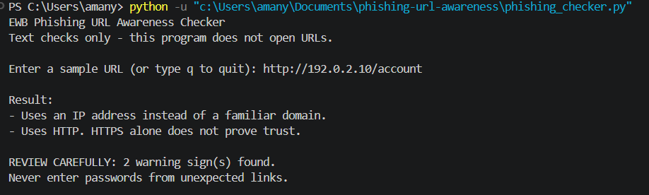
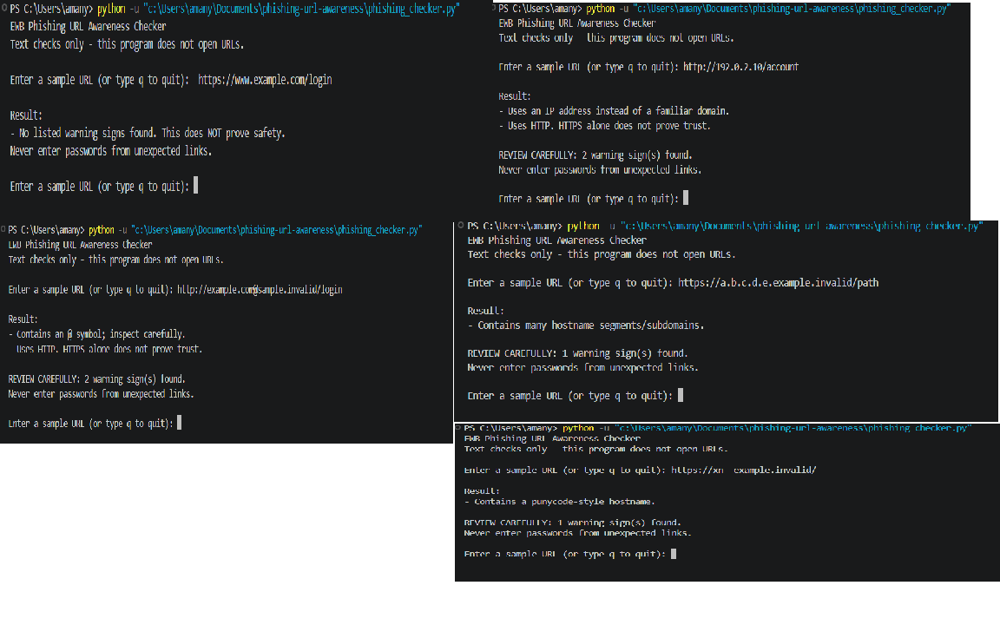

# EWB Phishing URL Awareness Checker

## Overview
Phishing is a trick where fake links or messages try to make people share
passwords, card numbers or OTPs. This command-line Python tool reads the text of
a URL and points out a few visible warning signs. It never opens the URL.

## Features
- Detects an @ symbol in the URL
- Flags unusually long URLs (over 100 characters)
- Flags IP-address hostnames
- Flags many hostname segments (5 or more)
- Flags punycode-style hostnames (xn--)
- Flags the HTTP scheme
- Loop mode: check many URLs in one run, type q to quit
- "REVIEW CAREFULLY" summary with the number of warnings found
- Malformed input is handled instead of crashing

## Requirements
Python 3.10 or later. No extra packages.

## How to Run
Windows: python phishing_checker.py
Mac/Linux: python3 phishing_checker.py

## Example Output
```
Enter a sample URL (or type q to quit): http://192.0.2.10/account

Result:
- Uses an IP address instead of a familiar domain.
- Uses HTTP. HTTPS alone does not prove trust.

REVIEW CAREFULLY: 2 warning sign(s) found.
Never enter passwords from unexpected links.
```

## Testing
| # | Input | Expected | Actual | Result |
|---|-------|----------|--------|--------|
| 1 | https://www.example.com/login | No warning signs | No listed warning signs found | PASS |
| 2 | http://192.0.2.10/account | IP address + HTTP | IP address and HTTP flagged | PASS |
| 3 | http://example.com@sample.invalid/login | @ symbol + HTTP | @ symbol and HTTP flagged | PASS |
| 4 | https://a.b.c.d.e.example.invalid/path | Many hostname segments | Many segments flagged | PASS |
| 5 | https://xn--example.invalid/ | Punycode-style hostname | Punycode flagged | PASS |

Full table: tests/test_samples.md

## Screenshots


## Improvements

1. **Loop with quit (A)** - The first version closed after one URL, so I
   had to restart it every time. I added a `while True` loop so I can check many
   URLs in one run, and typing `q`, `quit` or `exit` ends the program. I tested
   it by entering several sample URLs in a row and then typing `q`.

2. **Malformed input handling (C)** - Typing `http://[bad` made Python raise a
   `ValueError` and the program crashed. I wrapped the `urlparse` call in
   `try/except`, so it now prints "This text is not a valid URL format." and
   keeps running. I tested it by typing `http://[bad` and then re-running all
   five sample tests to make sure they still passed.

3. **Review carefully summary (B)** - Before this, the program only listed
   warnings. I added a `has_warnings()` helper that separates real warnings from
   information messages, and the program now prints "REVIEW CAREFULLY: N warning
   sign(s) found." when there are real warnings. I also added the invalid-URL
   message to the list of information messages so it isn't counted as a warning.
   I tested it with all five samples and checked that the count was correct.

## Limitations
This is an educational tool. It only reads URL text. It does not visit
URLs, scan for malware or prove that a URL is safe. No warning signs
found does NOT mean a URL is safe.

## Ethical Use
Use sample strings only. Do not collect credentials. Do not use this
project to deceive anyone or to test websites without permission.

## Author
[AMAN YADAV], [Ewb AI POWERED CYBERSECURITY INTERNSHIP], EWB Courses
